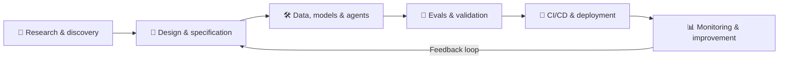

<h1 align="center">👋 Hi, I'm Daniel Raaid!</h1>

<strong>Senior GenAI Engineer · AI Tech Lead · Data Scientist · Author</strong>

<em>Turning research into reliable, useful AI systems.</em>

  
  
  
  

📍 Lisbon, Portugal &nbsp;|&nbsp; 🇵🇹 🇧🇷 Portuguese & Brazilian citizenship &nbsp;|&nbsp; 🌍 Remote collaborations

  
  
  

---

## 🧠 A little about me

Hey there! I'm **Daniel**, an AI engineer, technical lead, former university lecturer and author. I love taking complex ideas out of research papers and turning them into tools, systems and explanations that people can actually use.

I've spent **7+ years in data science, AI and data engineering**, working across cloud platforms, machine learning, NLP, LLMs and agentic systems. Before that, I worked in academia. My background in **bioinformatics** still shapes the way I think: start with a good question, look for evidence, then build something you can test.

These days, I'm especially interested in **agent orchestration, RAG, context compaction, caching and evaluation-driven development**. I write technical books and share hands-on labs because good engineering knowledge should be understandable, reproducible and accessible.

**A few things I enjoy working on:**
- 🤖 **Agentic AI:** multi-agent systems, tools, orchestration and dependable workflows.
- 📚 **RAG and knowledge systems:** retrieval, embeddings, vector search and quality evaluation.
- 🧠 **Context and cache engineering:** memory, token budgets, efficient inference and preservation of information.
- 🧪 **Reliable AI:** evaluation harnesses, benchmarks, observability and engineering feedback loops.
- ☁️ **Cloud-native ML:** Azure, AWS, GCP, Python services, MLOps and data pipelines.
- ✍️ **Technical education:** explaining the why, not just the how, with open-source exercises.

---

## 🛠️ My toolbox

### **Programming & Data**

### **AI & Machine Learning**

### **Vector Databases**

### **BI & Data Visualization**

### **Cloud & MLOps**

### **Agentic AI, Orchestration & Retrieval**

### **Data Platforms & Engineering**

### **DevOps, Observability & Delivery**

---

## 🔁 How I take AI from an idea to production

I like engineering that survives contact with the real world. That means defining a measurable goal, designing the system, building it, evaluating it properly, and keeping an eye on it after deployment.

| Practice | What I care about |
| --- | --- |
| 🔎 **Research-led design** | Defining requirements, constraints and evidence before building |
| 🧩 **Agent and RAG engineering** | Retrieval quality, tool integration, memory, reliability and traceability |
| 🧪 **Eval-driven delivery** | Quality gates, regression tests, measurable outcomes and failure analysis |
| 🐳 **Production operations** | Containers, cloud services, CI/CD, logging, monitoring and iteration |
| 🔐 **Responsible AI** | Privacy, human oversight, access control and auditable decisions |

---

## 📚 My books on Amazon

My technical books are available on **Amazon in paperback and Kindle editions**. The companion exercise repositories are free to access.

### 📘 Context Compaction in Agent Harness Engineering
*Theory, Mechanisms and Production Engineering*

An engineering guide to context lifecycles, compression, memory, information preservation, evaluation and the operation of long-running AI agents.

[Paperback](https://www.amazon.com.br/dp/B0HQ7CZN5B) · [Kindle](https://www.amazon.com.br/dp/B0HQ5H3NWX) · [Free exercises and code](https://github.com/danraid/context-compaction-exercises)

### 📗 Cache Engineering for AI Agent Harnesses
*Design, Correctness and Operations for Reuse in LLM-Powered Agents*

A practical and theoretical treatment of prompt, KV, semantic, retrieval and tool caching, with an emphasis on correctness, reuse and production behaviour.

[Paperback](https://www.amazon.com.br/dp/B0HR1KQR8P) · [Kindle](https://www.amazon.com.br/dp/B0HR1N1Q7W) · [Free exercises and code](https://github.com/danraid/cache-exercises)

### 📙 Eval-Driven Development
*Engineering Reliable AI Systems Through Evidence*

A research-informed approach to continuous AI evaluation, measurable quality, testing and evidence-based software development.

[Paperback](https://www.amazon.com.br/dp/B0HR1JV9HP) · [Kindle](https://www.amazon.com.br/dp/B0HQZPZ4Z7) · [Free exercises and code](https://github.com/danraid/edd-exercises)

**Fiction, under my pen name Dan Raaid:** [*Os Dois Nós* (Kindle)](https://www.amazon.com.br/dp/B0HQBXNBS5).

> Publication links above refer to Amazon listings verified in November 2026. Companion repositories provide independent learning materials; no purchase is required to use them.

---

## 🧩 Selected open-source projects

| Project | Focus |
| --- | --- |
| [RAG Knowledge Assistant](https://github.com/danraid/RAG-Knowledge-Assistant) | Retrieval-augmented knowledge assistant and document-aware AI |
| [Azure AI Agents MVP](https://github.com/danraid/ai-agents-azure-mvp) | AI agents and orchestration on Azure |
| [Azure Intelligent Document](https://github.com/danraid/Azure_Intelligent_Document) | Document intelligence, data extraction and AI pipelines |
| [Movie recommender with Neo4j and MLOps](https://github.com/danraid/movie-recommender-neo4j-mlops) | Graph data and applied machine learning |
| [Data Engineering Portfolio](https://github.com/danraid/Data-Engineering-Portifolio) | Data platforms, pipelines and engineering examples |
| [DNA Analysis](https://github.com/danraid/DNA-Analysis) | Computational and bioinformatics-oriented work |

---

## 💼 Professional experience

| Period | Role | Organisation |
| --- | --- | --- |
| 2026–present | Senior GenAI and Machine Learning Engineer | BySix / Mozantech |
| Since 2025 | Senior AI Engineer and AI Tech Lead | D-Plan One |
| 2019–2025 | Senior Data Scientist and Consultant | INFIN |
| 2023–2025 | Partner and Investment Advisor | Saron Investments |
| 2007–2021 | University lecturer, academic coordination and leadership roles | UniNorte and Faculdade Estácio do Amazonas |

Across these roles, I have worked on agentic workflows, AI-powered services, financial and operational analytics, natural language processing, predictive systems, dashboards, cloud architectures and engineering delivery.

---

## 🎓 Education

- **Postgraduate Specialisation, Software Engineering**, UNOPAR (2025)
- **Postgraduate Specialisation, Data Engineering**, UNOPAR (2025)
- **Bachelor's, Data Science**, UniFavip Wyden (2025)
- **Bachelor's, Financial Management**, UniFavip Wyden (2024)
- **Master's, Bioinformatics (Genetics)**, INPA (2006)
- **Bachelor's, Bioinformatics**, UFAM (2004)

---

## 📜 Certifications & professional learning  

---

## 📊 GitHub Stats  

  

---

## 📫 Let's connect

I'm always happy to exchange ideas about AI engineering, research, open-source tools and technical writing. If one of my projects sparks an idea, get in touch!

  
  
  
  

---

<strong>Curious about how AI works. Serious about making it work well. 🚀</strong>

